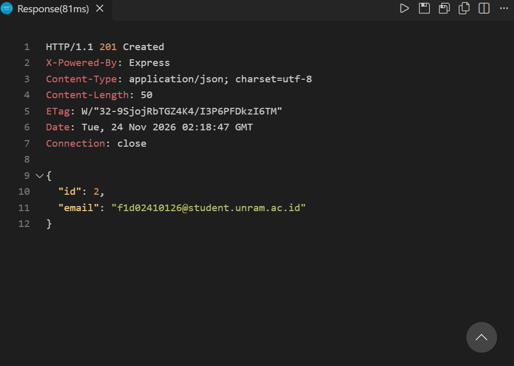
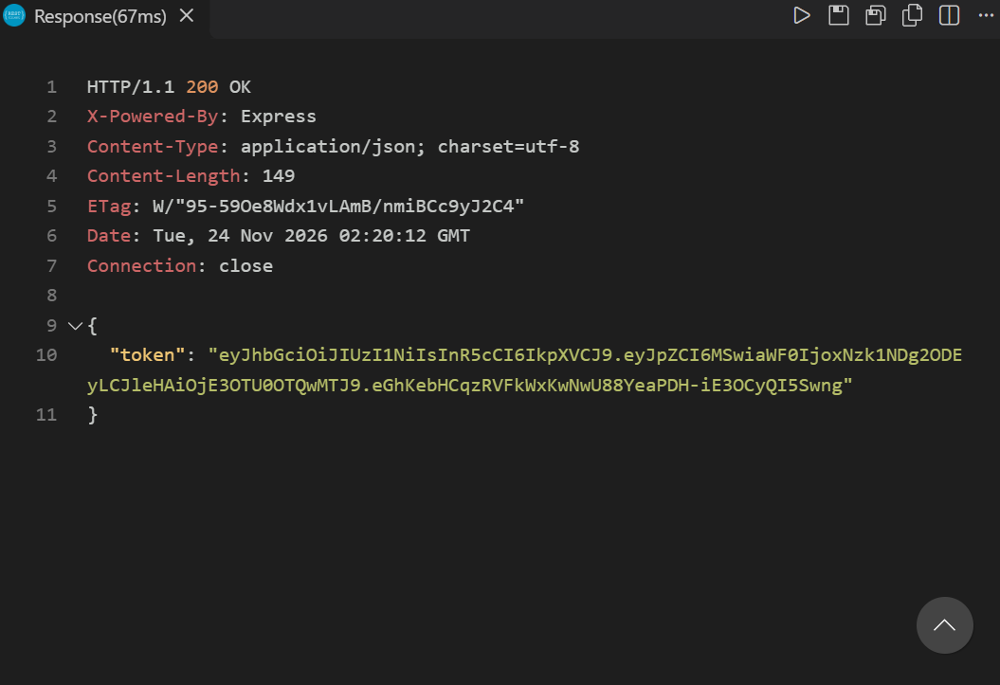
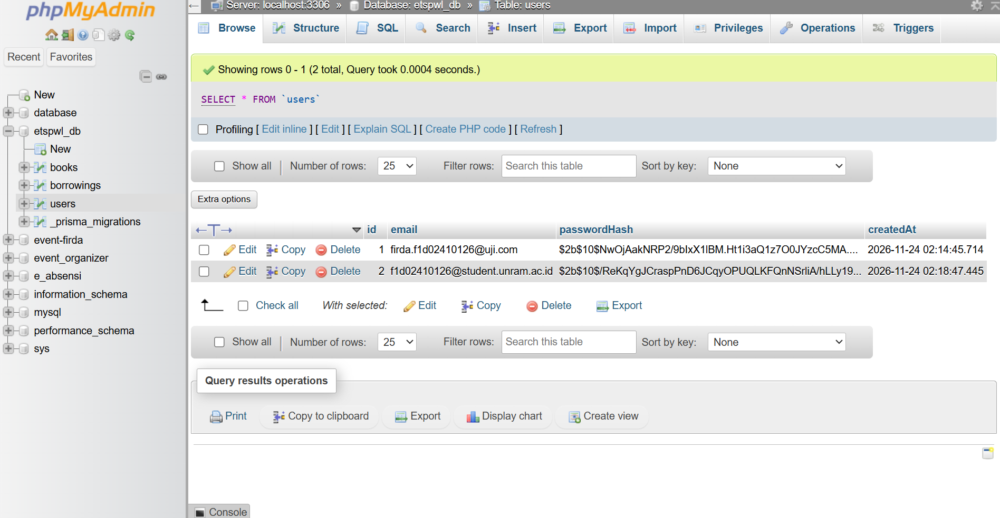
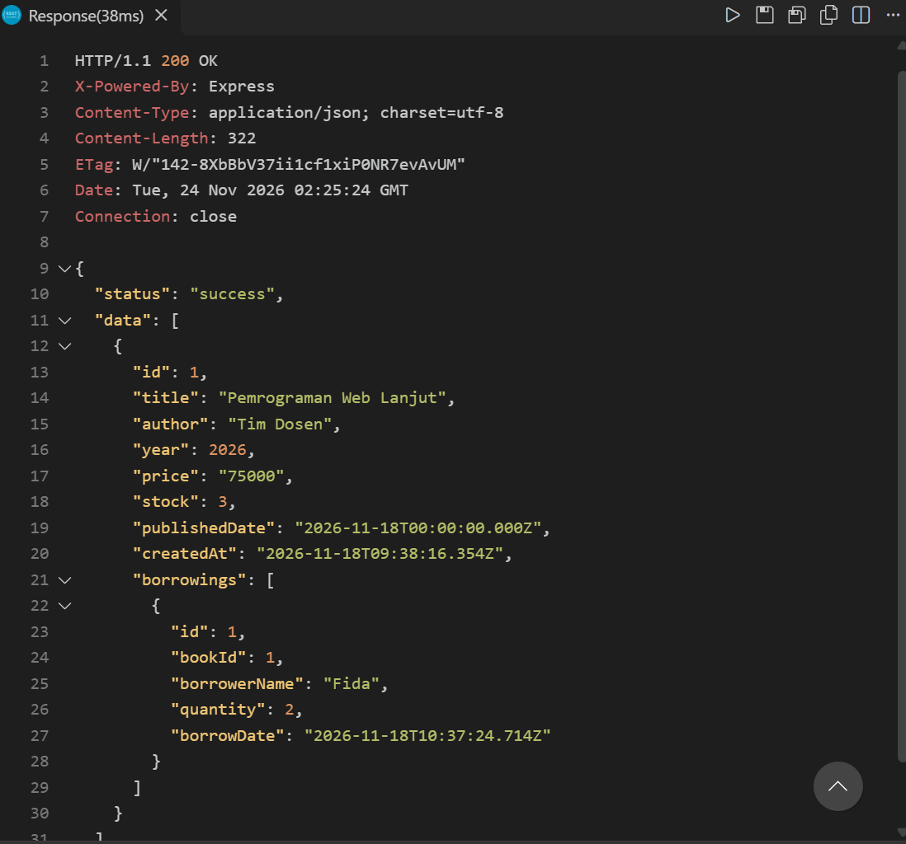
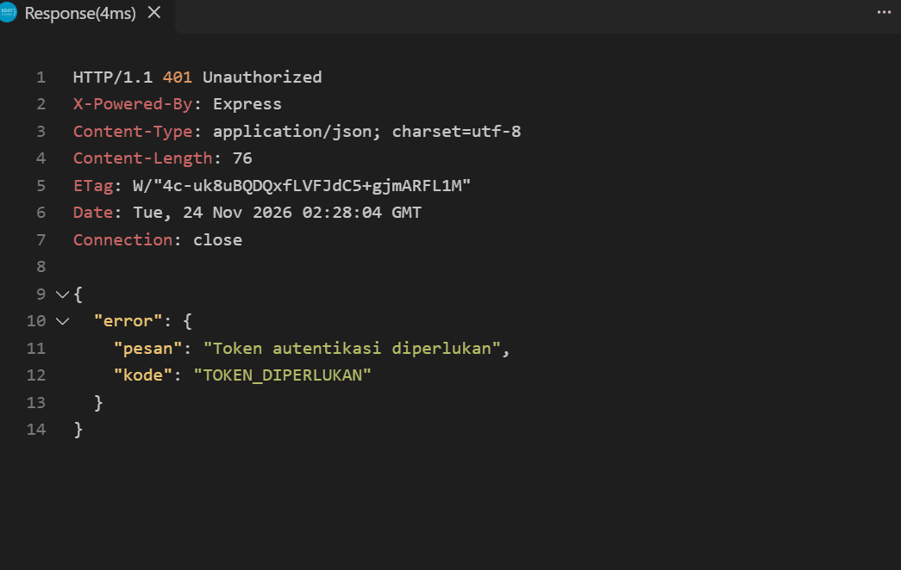
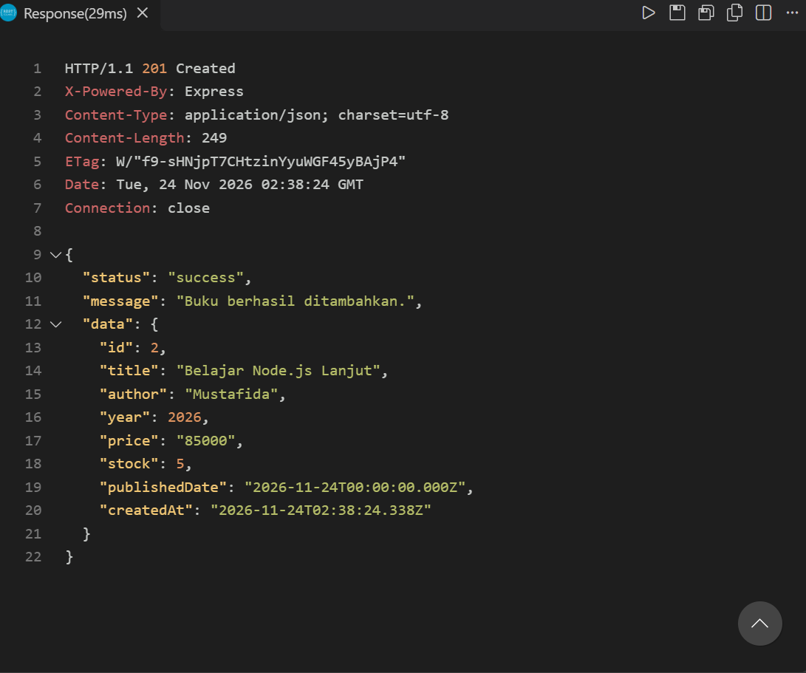
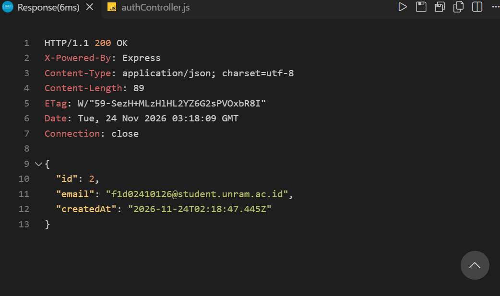
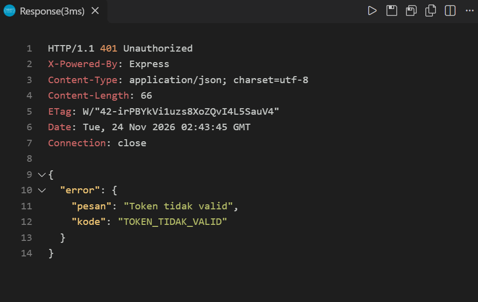
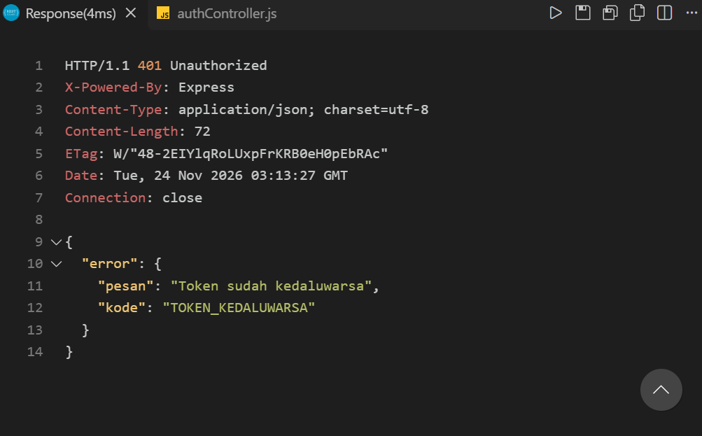

# Tugas 9 - Autentikasi & Otorisasi

## Identitas
- Nama : Mustafida
- NIM  : F1D02410126
- Kasus ETS : Books & Borrowings API (`T9-AUTENTIKASI`)

## Cara Menjalankan

1. **Clone / buka proyek dan instal dependensi**
   Pastikan Node.js dan MySQL (via Laragon/XAMPP) sudah aktif, lalu buka folder proyek `T9-AUTENTIKASI` dan jalankan:
   ```bash
   npm install
   ```

2. **Konfigurasi environment (`.env`)**
   Buat atau periksa file `.env` di root proyek dengan konfigurasi database, port, dan rahasia JWT:
   ```env
   DATABASE_URL="mysql://root:@localhost:3306/etspwl_db"
   PORT=3000
   JWT_SECRET="rahasia_jwt_f1d02410126_super_aman"
   ```

3. **Buat tabel `users` dan tabel terkait di database**
   Pastikan database `etspwl_db` sudah dibuat di MySQL/phpMyAdmin, lalu sinkronkan skema Prisma ke database:
   ```bash
   npx prisma generate
   npx prisma db push
   ```
   *(Atau jalankan `npx prisma migrate dev` jika menggunakan riwayat migrasi.)*

4. **Jalankan server API**
   ```bash
   node src/app.js
   ```
   Server akan berjalan pada `http://localhost:3000`. Pengujian endpoint dapat dilakukan menggunakan file `requests.http` dengan ekstensi REST Client di VS Code.

## Akun Uji

Akun uji dibuat melalui endpoint `POST /auth/register`:

| Email Akun Uji | Password Uji (Bukan Password Asli) | Keterangan |
| :--- | :--- | :--- |
| `f1d02410126@student.unram.ac.id` | `PasswordUji123!` | Akun uji utama (`id: 2`) yang digunakan untuk registrasi, login, dan akses endpoint terproteksi |
| `firda.f1d02410126@uji.com` | `PasswordUji123!` | Akun uji tambahan (`id: 1`) saat pengecekan profil dan pengujian token |

## Struktur Proyek

```text
T9-AUTENTIKASI/
├── .agents/
├── .claude/
├── .cursor/
├── .devin/
├── node_modules/
├── prisma/
│   ├── migrations/
│   │   ├── 20261117025659_init/
│   │   │   └── migration.sql
│   │   ├── 20261123141221_tambah_user/
│   │   │   └── migration.sql
│   │   └── migration_lock.toml
│   └── schema.prisma              # (Diubah) Skema database Prisma dengan tambahan model User
├── screenshots/                   # (Baru) Folder dokumentasi hasil pengujian & database (ubah ke screenshot/ jika menyesuaikan aturan soal)
├── src/
│   ├── controllers/
│   │   ├── authController.js      # (Baru) Logika bisnis untuk register, login, dan profil user (/auth/saya)
│   │   ├── bookController.js      # Logika bisnis pengelolaan data buku
│   │   └── borrowingController.js # Logika bisnis pengelolaan data peminjaman buku
│   ├── data/                      # Folder penyimpanan data awal / dummy data aplikasi
│   ├── middleware/
│   │   ├── auth.js                # (Baru) Middleware verifikasi JWT pada header Authorization
│   │   ├── errorHandler.js        # Middleware penanganan error terpusat
│   │   └── logger.js              # Middleware pencatat log setiap request masuk
│   ├── routes/
│   │   ├── authRoutes.js          # (Baru) Definisi rute autentikasi (/auth/register, /auth/login, /auth/saya)
│   │   ├── bookRoutes.js          # (Diubah) Definisi rute buku (publik untuk GET, wajib login untuk POST/PUT/DELETE)
│   │   └── borrowingRoutes.js     # (Diubah) Definisi rute peminjaman yang diproteksi autentikasi
│   ├── validators/
│   │   ├── authValidator.js       # (Baru) Validasi input email dan password untuk register dan login
│   │   └── borrowingValidator.js  # Validasi input data peminjaman buku
│   └── app.js                     # (Diubah) Konfigurasi utama Express dan registrasi rute autentikasi
├── .env                           # Konfigurasi variabel lingkungan lokal (DATABASE_URL, PORT, JWT_SECRET)
├── .env.example                   # Contoh template variabel lingkungan tanpa kredensial asli
├── .gitignore                     # Daftar file/folder yang diabaikan Git (seperti node_modules dan .env)
├── package-lock.json              # Pengunci versi dependensi npm proyek
├── package.json                   # Daftar dependensi dan skrip menjalankan aplikasi Node.js
├── prisma.config.ts               # Konfigurasi Prisma untuk memuat variabel lingkungan dan koneksi database
├── README.md                      # (Diubah) Dokumentasi tugas autentikasi, pengujian, dan analisis keamanan
└── requests.http                  # (Baru) Kumpulan skenario pengujian endpoint REST Client               
```

## Endpoint

| Method | URL | Akses | Status |
| :--- | :--- | :--- | :--- |
| `POST` | `/auth/register` | Publik | `201 Created` (berhasil), `400` / `409` (validasi gagal / email sudah terdaftar) |
| `POST` | `/auth/login` | Publik | `200 OK` (mengembalikan `token` JWT), `401 Unauthorized` (kredensial tidak valid) |
| `GET` | `/auth/saya` | Wajib login (`Bearer <token>`) | `200 OK` (data user login), `401 Unauthorized` (`TOKEN_DIPERLUKAN` / `TOKEN_TIDAK_VALID` / `TOKEN_KEDALUWARSA`) |
| `GET` | `/api/books` | Publik | `200 OK` (mengambil daftar buku beserta data terkait tanpa token) |
| `POST` | `/api/books` | Wajib login (`Bearer <token>`) | `201 Created` (menambah buku baru saat token valid), `401 Unauthorized` (tanpa/tidak valid token) |

## Pengujian

1. **Registrasi Akun Baru (`POST /auth/register`)**
   
   Registrasi akun `f1d02410126@student.unram.ac.id` berhasil dengan status `201 Created` dan mengembalikan data pengguna tanpa mengekspos `passwordHash`.

2. **Login Akun Uji (`POST /auth/login`)**
   
   Login menggunakan akun uji yang terdaftar berhasil dengan status `200 OK` dan menghasilkan JWT `token` untuk autentikasi request berikutnya.

3. **Struktur & Isi Tabel `users` di phpMyAdmin**
   
   Isi tabel `users` pada database menunjukkan kolom `passwordHash` tersimpan dalam bentuk hash kriptografis, bukan password teks asli.

4. **Akses Endpoint Publik Tanpa Token (`GET /api/books`)**
   
   Endpoint publik `GET /api/books` tetap dapat diakses tanpa header `Authorization` dan mengembalikan status `200 OK` beserta daftar buku.

5. **Akses Endpoint Terproteksi Tanpa Token (`401 TOKEN_DIPERLUKAN`)**
   
   Request ke endpoint yang dilindungi tanpa menyertakan token ditolak oleh middleware dengan status `401 Unauthorized` dan kode `TOKEN_DIPERLUKAN`.

6. **Akses Endpoint Terproteksi Dengan Token Valid (`POST /api/books` & `GET /auth/saya`)**
   
   
   Request dengan header `Authorization: Bearer <token>` valid berhasil diproses (menghasilkan `201 Created` saat menambah buku dengan `"author": "Mustafida"` dan `200 OK` saat mengambil profil `/auth/saya`).

## Dua Percobaan

### Percobaan 1: Token Dipalsukan / Diubah

- **Hasil:** `401 Unauthorized` dengan pesan `"Token tidak valid"` dan kode `"TOKEN_TIDAK_VALID"`.
- **Penjelasan:** Token JWT yang sudah diubah isinya/karakternya tidak lagi memiliki tanda tangan (*signature*) yang cocok dengan payload dan `JWT_SECRET` di server. Middleware autentikasi mendeteksi ketidaksesuaian verifikasi kriptografi tersebut sehingga request langsung ditolak sebelum masuk ke controller.

### Percobaan 2: Token Kedaluwarsa (`expiresIn` diuji singkat)

- **Hasil:** `401 Unauthorized` dengan pesan `"Token sudah kedaluwarsa"` dan kode `"TOKEN_KEDALUWARSA"`.
- **Penjelasan:** Ketika masa berlaku token diset singkat (`5s`) lalu pengujian dilakukan setelah batas waktu terlewati, klaim waktu kedaluwarsa (`exp`) pada JWT sudah lewat dari waktu server saat ini. Library verifikasi JWT melempar `TokenExpiredError` sehingga middleware mengembalikan respons `401` dengan kode `TOKEN_KEDALUWARSA` (dan setelah pengujian selesai, nilai `expiresIn` dikembalikan ke durasi normal).

## Deklarasi Penggunaan AI

| Bagian | Alat AI | Dipakai untuk apa | Cara saya memeriksa hasilnya |
|--------|---------|-------------------|------------------------------|
| `butuhLogin` | Gemini | Middleware membaca header Bearer | Uji POST tanpa token, hasilnya 401 |
| `requests.http` | Gemini | Menyusun daftar skenario request pengujian endpoint & percobaan token | Menjalankan tiap request di REST Client dan memeriksa status HTTP serta respons JSON-nya |
| `README.md` | Gemini | Merapikan draf dokumentasi dan struktur folder | Mengecek pratinjau Markdown di VS Code dan memastikan path gambar serta isi sesuai hasil uji |

Pernyataan: Saya menggunakan AI pada bagian yang tertulis di tabel.

Dalam pengerjaan tugas ini, AI digunakan sebagai asisten belajar untuk membantu menyusun struktur penjelasan, merapikan langkah pengujian di `requests.http`, menelusuri penyebab error saat pengujian, serta menyusun draf dokumentasi `README.md`. Seluruh kode, konfigurasi lingkungan, dan pengujian fungsional diperiksa, dijalankan, dan divalidasi langsung pada proyek lokal.

## Kesimpulan & Kendala

### Jawaban Pertanyaan
1. **Kenapa password di-hash, bukan dienkripsi?**
   *Hashing* bersifat satu arah (*one-way*) sehingga hash tidak dapat dikembalikan menjadi password asli bahkan jika bocor, sedangkan enkripsi bersifat dua arah karena memerlukan kunci dekripsi. Saat login, server cukup membandingkan hasil hash input password dengan `passwordHash` di database menggunakan fungsi perbandingan aman (`bcrypt.compare`) tanpa pernah perlu mengetahui password asli pengguna.

2. **Kenapa pesan login gagal dibuat sama untuk email tidak terdaftar dan password salah?**
   Pesan error dibuat generik (misalnya `"Email atau password salah"`) untuk mencegah *user enumeration*—yaitu teknik penyerang menebak email mana saja yang terdaftar di sistem berdasarkan perbedaan pesan error. Dengan menyamakan responsnya, penyerang tidak mendapat petunjuk tambahan apakah email tersebut ada di database atau hanya password-nya yang keliru.

3. **Apa bedanya halaman publik dan halaman wajib login pada proyek ini, dan dari mana server tahu sebuah token sah tanpa menyimpannya?**
   Endpoint publik (seperti `GET /api/books`) dapat diakses siapa saja tanpa token autentikasi, sedangkan endpoint wajib login (seperti `GET /auth/saya` atau `POST /api/books`) melewati middleware autentikasi yang mewajibkan token JWT valid pada header `Authorization`. Server tahu token sah tanpa menyimpannya di database/session karena JWT memiliki bagian *signature* yang dibuat menggunakan algoritma kriptografi dan `JWT_SECRET` rahasia di sisi server; saat request masuk, server memverifikasi ulang *signature* dan masa berlaku (`exp`) token tersebut secara *stateless*.

### Kendala dan Solusinya
- **Kendala:** Saat menguji token palsu di REST Client, header `Authorization` sempat lupa diawali kata `Bearer ` dan/atau token tidak diedit karakternya, sehingga respons yang muncul masih `TOKEN_DIPERLUKAN` atau token masih terbaca valid.
  **Solusi:** Memastikan format header selalu `Authorization: Bearer <token>` serta mengubah karakter pada token uji sebelum mengirim request sehingga menghasilkan `401` dengan kode `TOKEN_TIDAK_VALID`.
- **Kendala:** Saat menguji token kedaluwarsa, token harus melewati batas waktu singkat (`5s`) dan konfigurasi `expiresIn` perlu dikembalikan setelah uji selesai agar token normal tidak cepat mati.
  **Solusi:** Menunggu melewati batas waktu sebelum mengirim request `Percobaan 2` untuk mendapatkan `TOKEN_KEDALUWARSA`, lalu mengembalikan `expiresIn` ke nilai normal dan me-restart server.
- **Kendala:** Pengambilan tangkapan layar hasil pengujian sempat ditunda untuk dimasukkan ke `README.md`, sehingga saat menyusun kembali urutannya menjadi sedikit bingung dan memakan waktu lebih lama untuk mencocokkan tiap gambar dengan langkah pengujiannya.
**Solusi:** Mengelompokkan dan menamai ulang file tangkapan layar secara berurutan di dalam folder `screenshot/`, mencocokkannya satu per satu dengan urutan request di `requests.http`, lalu mengecek pratinjau `README.md` di VS Code untuk memastikan setiap gambar tampil tepat pada bagiannya.